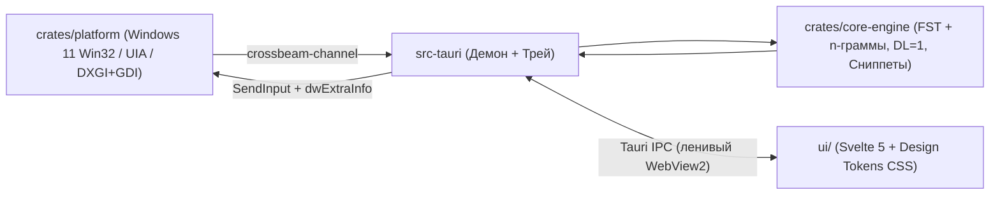

# KeyCraft

**Локальная детерминированная системная утилита для Windows 11** с чистым кроссплатформенным trait-слоем для macOS 14+ и Linux (X11/Wayland).

Бесплатный clean-room open-source аналог офлайн-возможностей KeyRay / Punto Switcher: автопереключение раскладки `RU ↔ EN`, исправление опечаток, текстовые сниппеты, управление регистром и списками, правила для приложений и офлайн-скриншотер с аннотациями и размытием.

> **100% офлайн · 0% ИИ и нейросетей · 0 сетевых запросов · `< 2 мс` на событие · `4.28 МБ` Private RAM в трее · `5.10 МБ` один файл**

[](https://github.com/arch-revan-dev/KeyCraft/releases/latest)
[](LICENSE)
[](https://github.com/arch-revan-dev/KeyCraft/actions/workflows/ci.yml)
[](https://github.com/arch-revan-dev/KeyCraft/releases/latest)
[](#безопасность-и-приватность)

*English summary: KeyCraft is a 100% offline, zero-AI, open-source (MIT) Windows 11 utility written in Rust + Tauri v2 + Svelte 5. It provides instant deterministic RU ↔ EN layout switching, DL=1 typo fixing, cross-layout text snippets, case cycling, smart list continuation, per-app rules & layout pinning, and a built-in screenshotter with annotations, pixelation, Gaussian blur, and always-on-top pinning.*

---

## Быстрый старт (Windows 11)

Установка не требуется — утилита работает из одного автономного файла:

1. Скачайте **`KeyCraft-v0.1.2-windows-x64.exe`** (или архив `KeyCraft-v0.1.2-windows-x64-portable.zip`) со страницы [Releases](https://github.com/arch-revan-dev/KeyCraft/releases/latest).
2. Запустите `KeyCraft.exe` — приложение свернётся в системный трей и покажет текущую раскладку (`RU` / `EN`).
3. Нажмите левой кнопкой по иконке в трее, чтобы открыть **Настройки** (или правой — для быстрого меню паузы и скриншотов).
4. При закрытии окна настроек WebView2 полностью выгружается из памяти; в фоне остаётся только чистый Rust-процесс (`~4.3 МБ` Private RAM).

---

## Возможности

| Модуль | Что делает |
|---|---|
| **Автопереключение `RU ↔ EN`** | Мгновенно переводит ошибочно набранные слова при пробеле/пунктуации (`ghbdtn` → `привет`, `руддщ` → `hello`, `дуеэы` → `let's`, `k.,k.` → `люблю`, `ye lf nen` → `ну да тут`), сохраняет регистр (`Ghbdtn` → `Привет`, `GHBDTN` → `ПРИВЕТ`), чинит случайный CapsLock (`пРИВЕТ` → `Привет`). |
| **Защита от ложных срабатываний** | Автоматически игнорирует URL (`https://...`), пути к файлам (`C:\...`, `/usr/...`), email, `camelCase`/`PascalCase`/`snake_case`, слова с цифрами, флаги CLI (`--release`) и смешанные идентификаторы. |
| **Спецсимволы и отмена** | Одиночное нажатие `Right Alt` меняет последний спецсимвол на парный из другой раскладки (`№ ↔ #`, `" ↔ @`, `; ↔ $`). `Esc` (или одиночный `Left Alt`) мгновенно отменяет последнее исправление. После 2–4 отмен одного слова оно автоматически добавляется в белый список (детерминированное локальное автообучение). |
| **Офлайн-исправление опечаток** | Детерминированный алгоритм `Damerau-Levenshtein = 1` с 2D-матрицей соседних клавиш QWERTY/ЙЦУКЕН и парами безударных русских гласных (`привте` → `привет`, `приввет` → `привет`, `привнт` → `привет`, `сматришь` → `смотришь`, `teh` → `the`, `hllo` → `hello`). Срабатывает только при однозначном частотном совпадении. |
| **Пользовательский словарь** | Хранит ваши термины, бренды и аббревиатуры, защищает их от автопереключения и учитывает при конвертации. Глобальный хоткей добавления выделенного слова (`Ctrl+Alt+D`), поиск, фильтры и импорт/экспорт JSON. |
| **Автоподмены (Text Expander)** | Поддержка нескольких триггеров через пробел, режимов `Space` / `Tab` / `Мгновенно` и опции «В любой раскладке» (`+админ` сработает при вводе `+flvby`). Предустановлены: `р- Р-` → `₽`, `---` → `—`, `<<` → `«`, `>>` → `»`, `+-` → `±`, `->` → `→`, `(c)` → `©`. |
| **Регистр и умные списки** | Циклическая смена регистра выделения или последнего слова (`привет мир` → `Привет мир` → `ПРИВЕТ МИР` → `Привет Мир`), автокапитализация начала предложения, продолжение списков `1. `, `1) `, `- `, `• `, `* ` по `Enter` и аккуратный выход при повторном `Enter` на пустом пункте. |
| **Правила для приложений** | Гранулярные флаги отключений по процессам (предустановлены `WindowsTerminal`, `Code`, `idea64`, `pwsh`, `cmd`, `Alacritty`, `WezTerm`, `iTerm2`) и автоматическая фиксация стартовой раскладки (`EN` / `RU`) при переключении фокуса. |
| **Офлайн-скриншотер** | Захват области, активного окна (без невидимых теней DWM) или всего виртуального экрана. Лупа-прицел, размеры `W × H`, стрелка, прямоугольник, эллипс, линия, маркер, текст, нумерованные шаги `1/2/3`, пикселизация, 2-проходный Gaussian Blur, Undo/Redo, копирование (`Enter`/`Ctrl+C`), сохранение PNG (`Ctrl+S`) и закрепление поверх окон (нативное Win32-окно). |
| **Индикация и песочница** | Динамическая иконка трея (`RU` / `EN` / Пауза), нативный Win32-бейдж раскладки у каретки (700 мс), встроенная песочница «Тест-драйв» с замером латентности, светлая (*Warm Studio Paper*) и тёмная (*Deep Tactile Graphite*) темы, экспорт/импорт всех настроек в один JSON. |

---

## Горячие клавиши по умолчанию

Все сочетания переназначаются в разделе **Горячие клавиши**:

| Действие | Сочетание |
|---|---|
| Конвертировать последнее слово или выделенный текст | `Pause` |
| Отменить последнее автопереключение / исправление | `Esc` *(можно переназначить на одиночный `Left Alt`)* |
| Заменить последний спецсимвол (`№ ↔ #`, `" ↔ @`, `; ↔ $`) | Одиночный `Right Alt` |
| Циклическая смена регистра | `Alt + Shift + U` |
| Добавить выделенное слово в словарь | `Ctrl + Alt + D` |
| Скриншот области | `PrintScreen` |
| Скриншот активного окна | `Alt + PrintScreen` |
| Скриншот всего экрана | `Ctrl + PrintScreen` |

---

## Безопасность и приватность

KeyCraft спроектирован по принципу **Zero-Keylogger Architecture** (подробности в [SECURITY.md](SECURITY.md)):

- **Никаких сетевых соединений:** в рантайм-дереве `keycraft` нет HTTP/WebSocket-клиентов (`reqwest`, `hyper`, `ureq` и т.п.), а CSP в `tauri.conf.json` блокирует любые внешние хосты.
- **Никаких ИИ и облачных API:** встроенный бинарный FST-словарь (`48 676` RU + `48 283` EN слов) и таблицы биграмм/триграмм компилируются внутрь бинарника (`~1.03 МБ`), работают локально за `< 0.5 мс`.
- **Защита паролей:** фоновый COM-поток `UIAutomation` отслеживает `UIA_IsPasswordPropertyId` активного поля ввода; в полях паролей буфер слова немедленно затирается и перехват отключается.
- **RAM-only буфер:** буфер текущего слова ограничен 64 символами, очищается через `zeroize` при пробеле, клике мыши, смене окна или навигации и никогда не записывается в логи или на диск.

---

## Архитектура



```text
keycraft/
├── .agents/rules/         # Инварианты архитектуры и Anti-Slop дизайн-контракт
├── data/wordlists/        # Открытые частотные словари RU/EN (исходники для офлайн-индекса)
├── tools/dict-builder/    # Генератор бинарных FST-карт и таблиц n-грамм
├── crates/core-engine/    # 100% кроссплатформенная чистая логика (72 unit-теста)
├── crates/platform/       # Trait PlatformBackend + Windows 11 + каркасы macOS/Linux
├── src-tauri/             # Фоновый демон, динамический трей, keycraft-capture://, IPC
└── ui/                    # Svelte 5 + TypeScript + чистый CSS (настройки + оверлей)
```

---

## Сборка из исходников (Windows 11)

### Требования
- **Rust** (`stable-x86_64-pc-windows-msvc` + Visual Studio C++ Build Tools **или** `stable-x86_64-pc-windows-gnu` + WinLibs MinGW-w64)
- **Node.js** 20+ и **WebView2 Runtime** (предустановлен в Windows 11)

### Команды сборки

```powershell
# 1. (Опционально) Пересобрать встроенные словари FST и n-граммы
cargo run -p keycraft-dict-builder --release

# 2. Проверить и собрать фронтенд (Svelte 5 + TypeScript + Vite)
cd ui
npm.cmd install
npm.cmd run check
npm.cmd run build
cd ..

# 3. Проверить линтинг и прогнать 72 unit-теста
cargo clippy --workspace --all-targets -- -D warnings
cargo test --workspace

# 4. Собрать автономный релизный бинарник (~5.10 МБ)
cargo build --release -p keycraft
```

Готовый файл: `target/release/keycraft.exe`.

---

## Портирование на macOS и Linux

Вся текстовая и словарная логика изолирована в `crates/core-engine` и не зависит от ОС. Для запуска на других платформах достаточно реализовать trait `PlatformBackend` (`crates/platform/src/lib.rs`):

- **macOS 14+** (`crates/platform/src/macos/mod.rs`): `CGEventTap`, `IsSecureEventInputEnabled` + `AXUIElement`, `TISSelectInputSource`, `ScreenCaptureKit`.
- **Linux X11 / Wayland** (`crates/platform/src/linux/mod.rs`): `XRecord` / `XTest` / `XkbLockGroup` / AT-SPI2 или `xdg-desktop-portal`.

Подробности для контрибьюторов — в [CONTRIBUTING.md](CONTRIBUTING.md).

---

## Лицензия и источники словарей

- Исходный код **KeyCraft** распространяется под лицензией [MIT](LICENSE).
- Частотные словари в `data/wordlists/` основаны на открытом наборе FrequencyWords (OpenSubtitles 2018, CC-BY-SA 4.0) и дополнены списком слов с `ё` и английских сокращений — подробности в [data/wordlists/LICENSE_WORDLISTS.md](data/wordlists/LICENSE_WORDLISTS.md).
